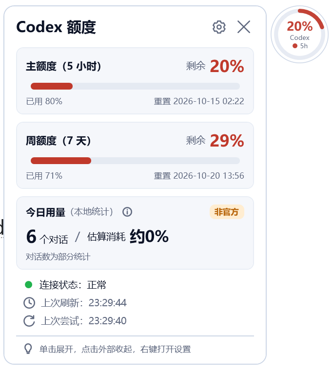
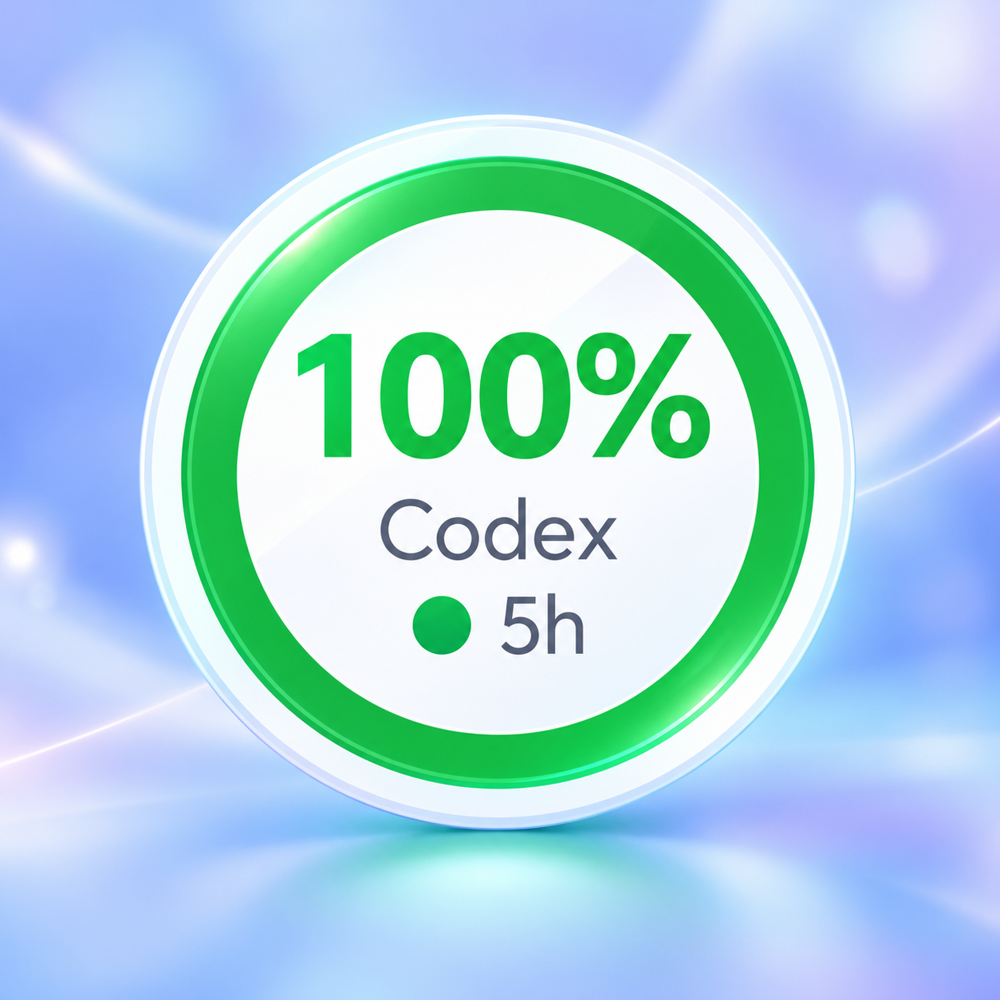
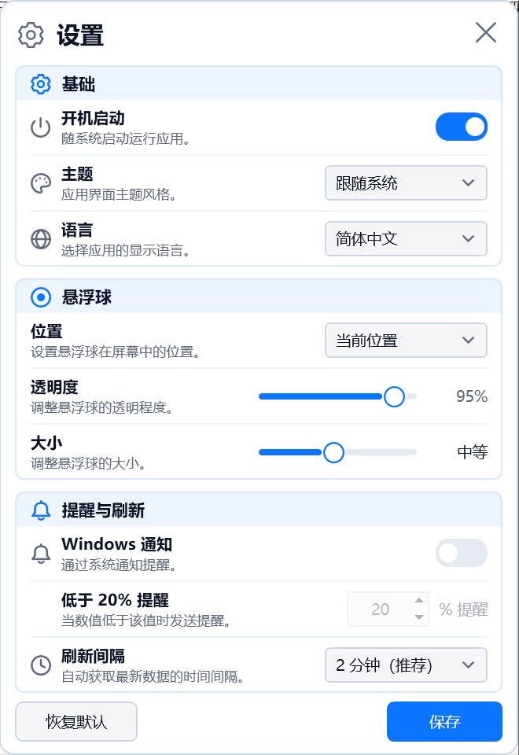
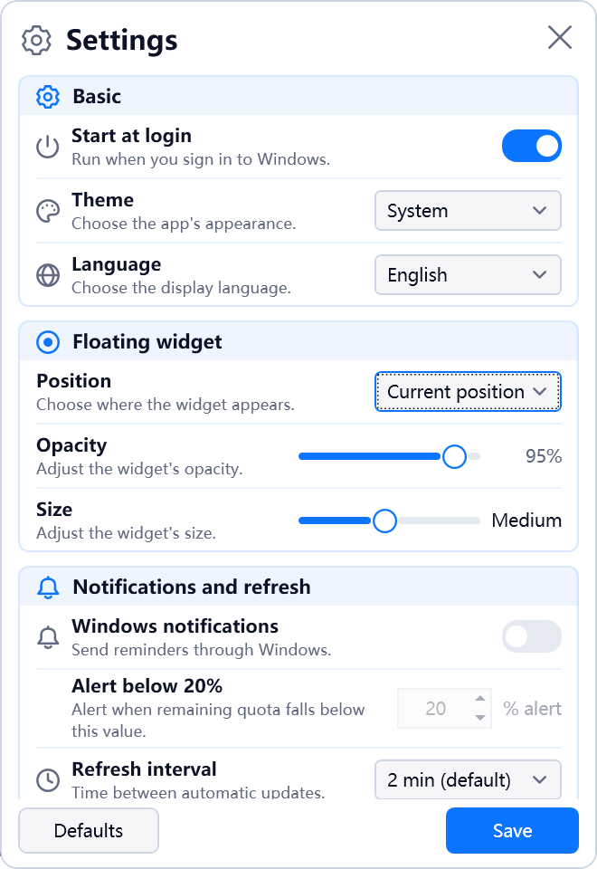

<div align="center">

# CodexQuota · Codex 额度悬浮球

<p align="center">
  <strong>Keep your remaining Codex quota resident at a glance on your Windows desktop.</strong>
</p>
<p align="center">
  <em>让 Codex 剩余额度，常驻桌面的一角。</em>
</p>

[](https://github.com/Clearelk/CodexQuota/releases)
[](https://github.com/Clearelk/CodexQuota)
[](https://dotnet.microsoft.com/)
[](https://github.com/Clearelk/CodexQuota)
[](LICENSE)
[](https://github.com/Clearelk/CodexQuota)

<p align="center">
  <strong>English</strong> &nbsp;|&nbsp; <a href="README.zh-CN.md">简体中文</a>
</p>

<p align="center">
  
</p>

</div>

---

## Introduction

**CodexQuota** is a lightweight, non-intrusive Windows desktop floating ball widget designed for OpenAI Codex users.

When writing code or collaborating with AI programming assistants, you no longer need to switch tabs or run command-line queries to check your remaining quota. CodexQuota connects directly to your locally authenticated official Codex CLI via its local JSON-RPC interface (`codex app-server`), safely fetching your 5-hour and 7-day subscription quotas in read-only mode and displaying real-time percentages in a clean desktop widget.

- ⚡ **Always-on Desktop Floating Ball**: Circular progress ring with 3 battery-level color tiers (Green / Yellow / Red).
- 🔍 **Hover for Instant Details**: Popout card displays 5-hour and 7-day primary quotas, precise second-level reset countdowns, and daily local session metrics.
- 🧲 **Smart Edge Docking**: Drag to screen edges to auto-collapse into a subtle quota capsule; hover to smoothly expand without blocking your code view.
- 🎨 **Appearance & Bilingual Localization**: Light/Dark mode or follow system, with built-in instant language switching (English / 简体中文).
- 📊 **Local Daily Usage Estimation**: Independently tallies local active sessions today and tracks quota consumption trends during runtime.
- 🔔 **Low Quota Alert**: Configurable warning threshold with native Windows banner notifications.
- 🛡️ **Zero Privacy Risks**: Pure local inter-process communication (IPC), zero prompt/inference calls, and no cookies, credentials, or tokens extracted.

> [!NOTE]
> This widget is primarily tailored for **Codex with ChatGPT subscription plans (Plus / Pro / Team)**. Third-party API Key billing and non-ChatGPT login modes are currently not within the scope of this widget.

---

## Table of Contents

- [Introduction](#introduction)
- [Feature Preview](#feature-preview)
- [Quick Start](#quick-start)
  - [Prerequisites](#prerequisites)
  - [Installation & Running](#installation--running)
- [Usage Guide](#usage-guide)
- [Settings](#settings)
- [Quota Mechanism & Privacy](#quota-mechanism--privacy)
- [Troubleshooting & FAQ](#troubleshooting--faq)
- [Build from Source](#build-from-source)
- [Project Structure](#project-structure)
- [Stay Updated](#stay-updated)
- [Contributing](#contributing)
- [License](#license)
- [References & Acknowledgements](#references--acknowledgements)

---

## Feature Preview

### 1. Quota Floating Ball
The circular progress ring and percentage reflect your active 5-hour quota window. Supports multi-monitor placement and free dragging across screens.
- **≥ 67%**: Green (Sufficient quota)
- **34% – 66%**: Yellow (Moderate usage)
- **< 34%**: Red (Critical quota alert)

<p align="center">
  
</p>

### 2. Quota Details Main Interface
Hover over the floating ball for ~300ms to pop out the details card, or click to pin it open. Displays 5-hour and 7-day primary quota buckets, exact reset timestamps, and local session counts.

<p align="center">
  
</p>

### 3. Edge Docking (Side Capsule Mode)
When dragged off the left or right edge of the screen by about 1/4 of its diameter, the ball smoothly collapses into an edge-docked quota capsule. Hovering expands it back to full size.

<p align="center">
  
</p>

### 4. Settings Panel (Bilingual Interface)
Organized into intuitive category cards. Supports instant UI language switching (English / 简体中文), scale, opacity, alert thresholds, and corner docking presets.

<p align="center">
  
  &nbsp;&nbsp;&nbsp;&nbsp;
  
</p>

---

## Quick Start

### Prerequisites

| Item | Requirement |
|---|---|
| **Operating System** | Windows 10 / 11 (x64) |
| **Official Codex CLI** | Installed on your machine and logged in via ChatGPT account |
| **.NET Runtime** | **Not required** (the self-contained distribution includes all necessary runtimes) |

> If you haven't installed or logged into the Codex CLI yet:
> 1. Follow the official installation guide: [OpenAI Codex CLI Guide](https://developers.openai.com/codex/cli)
> 2. Open PowerShell or Terminal and execute `codex`
> 3. Select **Sign in with ChatGPT** and complete web authentication.

---

### Installation & Running

#### Windows

1. Download the latest release archive `CodexQuota_v{version}_windows_x64.zip` from [GitHub Releases](https://github.com/Clearelk/CodexQuota/releases).
2. Extract the package and double-click `CodexQuota.Desktop.exe` (Portable self-contained build, no extra .NET runtime required).
3. The widget will automatically detect your local official Codex CLI and show up on your desktop!

> [!TIP]
> The widget connects to your local official CLI environment automatically. It does not provide or require an account login form of its own.

---

## Usage Guide

### Interactive Controls

| Gesture / Action | Result |
|---|---|
| **Hover Floating Ball** | Pops up the quota details panel after ~300ms; smoothly hides when the mouse leaves |
| **Click Floating Ball** | Pins the quota details panel open; click again to close |
| **Drag Floating Ball** | Move the ball anywhere across all connected displays; remembers position upon release |
| **Drag off Left/Right Screen Edge** | Drag ~1/4 of the ball off-screen to collapse into an "Edge Capsule" |
| **Hover Edge Capsule** | Temporarily expands the full floating ball; drag inwards to exit docking mode |
| **Right-Click Floating Ball** | Opens context menu (Refresh / Details / Settings / Exit) |
| **Double-Click Tray Icon** | Toggles the pinned quota details panel |
| **Right-Click Tray Icon** | System tray menu (Show/Hide ball, Settings, Refresh, Launch on Startup, Exit) |
| **Keyboard Shortcuts** | When focused on the ball: `Enter` or `Space` toggles details; `Esc` dismisses the panel |

---

## Settings

Click the ⚙️ gear icon in the details panel or select **Settings** from the context / tray menu:

| Category | Option | Description & Range |
|---|---|---|
| **Appearance & Language** | Language | `Simplified Chinese`, `English` (Real-time dynamic UI translation) |
| | Theme | `Follow System`, `Light`, `Dark` |
| | Scale | `75%` to `150%` (Default: 100%), scales ball, text, and hit-test areas |
| | Opacity | `40%` to `100%` (Applies only to the floating ball) |
| **Position** | Docking Presets | One-click positioning to screen corners (Top-Left, Top-Right, Bottom-Left, Bottom-Right) |
| **Refresh & Alerts** | Refresh Interval | `30s`, `1m`, `2m` (Default), `5m`, `10m`, `15m` |
| | Low Quota Threshold | `1%` – `100%` (Default: 20%), triggers visual warning when 5-hour quota drops below |
| | Windows Notifications | Displays a native notification banner on low quota (debounced per low cycle) |
| **System** | Launch on Startup | Runs silently in the background on Windows user sign-in |

> Configuration file path:
> ```text
> %LOCALAPPDATA%\CodexQuotaWidget\settings.json
> ```

---

## Quota Mechanism & Privacy

### 1. Genuine 5-Hour & 7-Day Quotas
- The floating ball reflects the official primary 5-hour quota window.
- The details panel shows both 5-hour and 7-day quotas alongside exact local reset times.
- Expired data displays neutral `--` markers rather than falsely assuming 100% availability.

### 2. Local Session Statistics (Unofficial)
- Daily session counts are parsed locally from session records under `CODEX_HOME` (sessions with today's activity).
- Estimated quota consumption tracks delta usage between observed snapshots during the application's runtime.

### 3. Security & Privacy Guarantees
- **Pure Local IPC**: Communicates with the local `codex app-server` process via standard stdio pipes; data remains exclusively in local RAM.
- **No Token Harvesting**: Never accesses, copies, or logs `auth.json` or session tokens.
- **Read-Only Whitelist**: Calls only `initialize`, `account/read`, and `account/rateLimits/read`. Never sends user prompts, code snippets, or inference requests.

---

## Troubleshooting & FAQ

### Q1: "Official Codex client not found"?
1. Open PowerShell and run `codex --version` to check if CLI is reachable from `PATH`.
2. The app searches system `PATH`, global npm paths, and standard standalone installation folders.
3. If using an npm wrapper script, ensure Node.js is installed.

### Q2: "Official client not logged in"?
1. Run `codex` in your terminal and complete ChatGPT login.
2. Once logged in, right-click the floating ball and click **Refresh Now**.

### Q3: The floating ball disappeared. How to recover it?
1. Find the CodexQuota icon in the Windows taskbar system tray.
2. Right-click and choose **Show Floating Ball**.
3. If lost due to display resolution changes, open Settings and pick a corner preset (e.g., Top-Right) to pull it back onto your primary monitor.

### Q4: Low quota notifications not popping up?
1. Check if **Windows Notifications** is enabled and saved in the Settings panel.
2. Ensure Windows "Focus Assist / Do Not Disturb" is not suppressing app banners.
3. Notifications only fire once per low-quota occurrence until quota replenishes.

---

## Build from Source

Requirements:
- Windows 10 / 11 x64
- [.NET 10 SDK](https://dotnet.microsoft.com/download/dotnet/10.0)

Run the automated scripts in PowerShell:

```powershell
# 1. Run full verification pipeline (build, 300+ unit tests, code format, self-contained publish)
powershell -NoProfile -ExecutionPolicy Bypass -File scripts/verify.ps1

# 2. Publish standalone self-contained Windows x64 release
powershell -NoProfile -ExecutionPolicy Bypass -File scripts/publish.ps1

# 3. Test run the compiled binary
.\artifacts\win-x64\CodexQuota.Desktop.exe
```

> Output binary is placed in `artifacts/win-x64/` as a portable standalone executable.

---

## Project Structure

```text
CodexQuota/
├── .github/
│   └── workflows/
│       └── ci.yml               # GitHub Actions CI automated build & test pipeline
├── src/
│   ├── CodexQuota.Core/         # Core: JSON-RPC IPC, quota decoding, local usage & settings
│   └── CodexQuota.Desktop/      # Desktop: WPF floating ball, details card, settings & tray
├── tests/
│   ├── CodexQuota.Tests/        # 300+ automated regression and unit test cases
│   └── CodexQuota.FakeServer/   # IPC process mock server for offline testing
├── scripts/
│   ├── publish.ps1              # Standalone x64 publishing script
│   ├── verify.ps1               # Complete build, test & format check script
│   └── desktop-smoke.ps1        # Desktop UI smoke & memory measurement script
├── docs/                        # Protocol specs, design references & verification docs
├── images/                      # Screenshot assets for README
├── CHANGELOG.md                 # Version release changelog
├── CONTRIBUTING.md              # Community contribution guidelines
├── LICENSE                      # MIT Open Source License
├── README.md                    # English documentation (Default)
├── README.zh-CN.md              # Chinese documentation (简体中文)
└── CodexQuota.slnx              # Visual Studio solution file
```

---

## Stay Updated

- 🌟 If this widget helps your coding workflow, consider giving it a **Star** on GitHub!
- 👁️ Click **Watch** at the top right to stay notified of new releases.
- 🐛 Found a bug or have an idea? Feel free to open an issue at [GitHub Issues](https://github.com/Clearelk/CodexQuota/issues).

---

## Contributing

Contributions are warmly welcomed! Please read the [Contributing Guide](CONTRIBUTING.md) for full details. Before submitting a PR, make sure all tests pass:

```powershell
powershell -NoProfile -ExecutionPolicy Bypass -File scripts/verify.ps1 -SkipPublish
```

---

## License

This project is licensed under the [MIT License](LICENSE).

---

## References & Acknowledgements

- [OpenAI Codex CLI](https://developers.openai.com/codex/cli): Official client architecture and `app-server` interface design.
